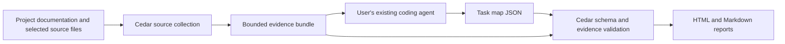

# Architecture

Cedar helps agent teams turn product evidence into reviewable experiment plans. The initial release implements onboarding. The task map is a starting point for evaluation design, not a measured coverage score.

## Components

- **Host Skill:** `skills/cedar-onboard/SKILL.md` guides the existing coding agent through source selection, semantic analysis and corrections. It provides a pinned command that obtains Cedar without a checkout.
- **CLI:** `src/cli.ts` coordinates collection, validation and reporting. Bundled resources are resolved relative to the package, independent of the working directory.
- **Collector:** `src/collect.ts` creates bounded text snapshots with source identifiers, hashes, scope and omissions. Git repositories use their file inventory; other directories use bounded traversal.
- **Validator:** `src/coverage.ts` checks the schema, bundle integrity, source identifiers, exact quotations and line ranges. It enforces the distinction between documented and inferred tasks, existing and proposed checks, and execution blockers.
- **DSH inspection:** `src/dsh.ts` identifies static integration clues. It does not launch DSH or verify runtime compatibility.
- **Reports:** `src/report.ts` renders self-contained HTML and Markdown with citations, gaps and unresolved questions. HTML uses escaped content and a restrictive content security policy.

## Responsibility boundaries

The host coding agent supplies model reasoning. Cedar's CLI has no model provider, API credentials or hosted inference. Project content is read by the host agent according to that agent's own data handling; local CLI execution does not imply that the host model runs locally.

Source text is evidence, not authority to run commands. Onboarding does not install target dependencies, invoke target tools or execute target tests. Outputs must be new directories outside the target, including after resolving filesystem links. Captured source integrity is checked independently of Git commit identity.

Exact citations demonstrate where text came from. They do not establish that the cited text supports the conclusion. The host and reviewer must assess semantic support, conflicting expectations and missing behavior. Reports retain that uncertainty.

Customer names, business rules and domain-specific judgments belong in project inputs and generated plans. Cedar's core should depend on runtime capabilities and general evidence contracts.

## Distribution

The versioned GitHub Skill is the user entry. npm fetches the matching prebuilt release tarball and its pinned runtime dependency into a cache. The agent runs it from a neutral directory and passes absolute paths. No permanent Skill installation, global CLI installation or TypeScript build is required for users.

The tarball contains only compiled runtime JavaScript, the Skill, package metadata, README and license when present. Source, tests and development documentation remain in the GitHub repository.

## Next stages

The next execution milestone is one DSH task in isolated, resettable state with explicit inputs and observable outputs. Runtime fidelity must be checked before baseline/candidate comparisons are meaningful. Later stages can add reusable experiment definitions, comparative evidence and development feedback.

Actual execution, offline A/B, statistical comparison and autonomous improvement are not capabilities of this release.
